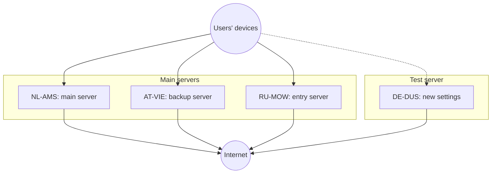

# Network Topology

> The project is archived: the servers were shut down in 2026. This page describes how the servers were set up before that.

## Overview

The service ran on 4 independent servers. They did not depend on each other: if one failed, the others kept working, and users were switched to another server manually.

## Diagram

## Servers

| Server | Role | Location | Software |
|:--|:--|:--|:--|
| **NL-AMS** | Main server | Amsterdam, Netherlands | Ubuntu 22.04 + Docker (Outline, 3x-ui) |
| **AT-VIE** | Backup server | Vienna, Austria | Ubuntu 22.04 + 3x-ui |
| **RU-MOW** | Entry server | Moscow, Russia | Ubuntu 20.04 + 3x-ui |
| **DE-DUS** | Test server for new settings | Düsseldorf, Germany | Ubuntu 24.04 + Remnawave |

## Management

- **Access:** SSH with a password. Moving to SSH keys was planned.
- **Settings:** tracked in a local Git repository.
- **Monitoring:** scripts checked the servers on a schedule and sent alerts to Telegram.
